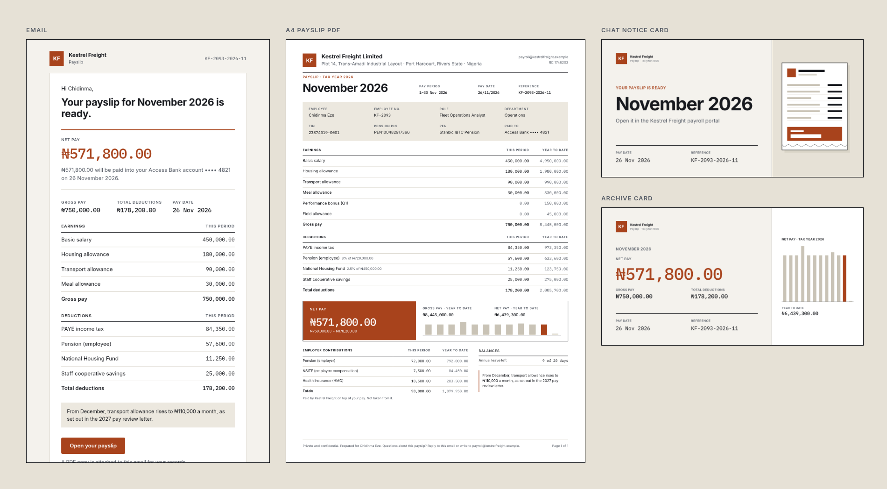
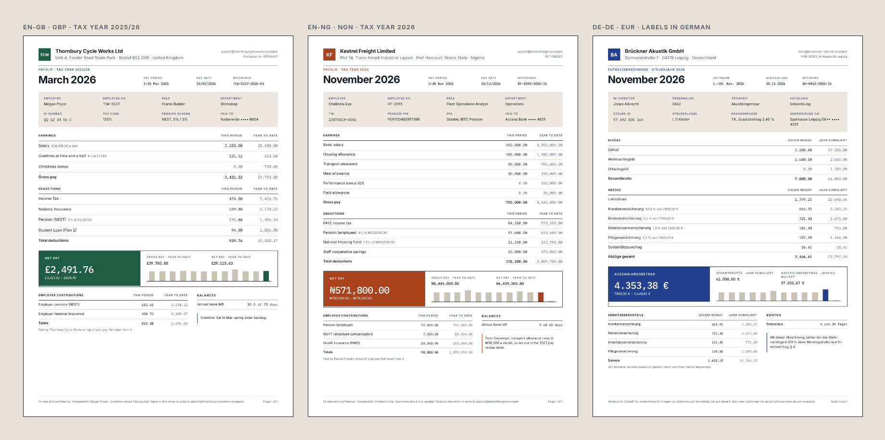
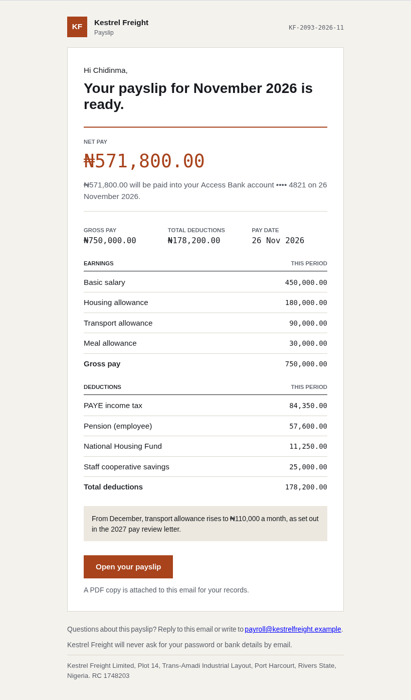
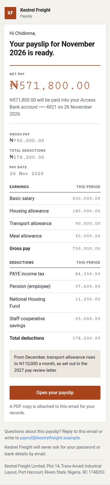
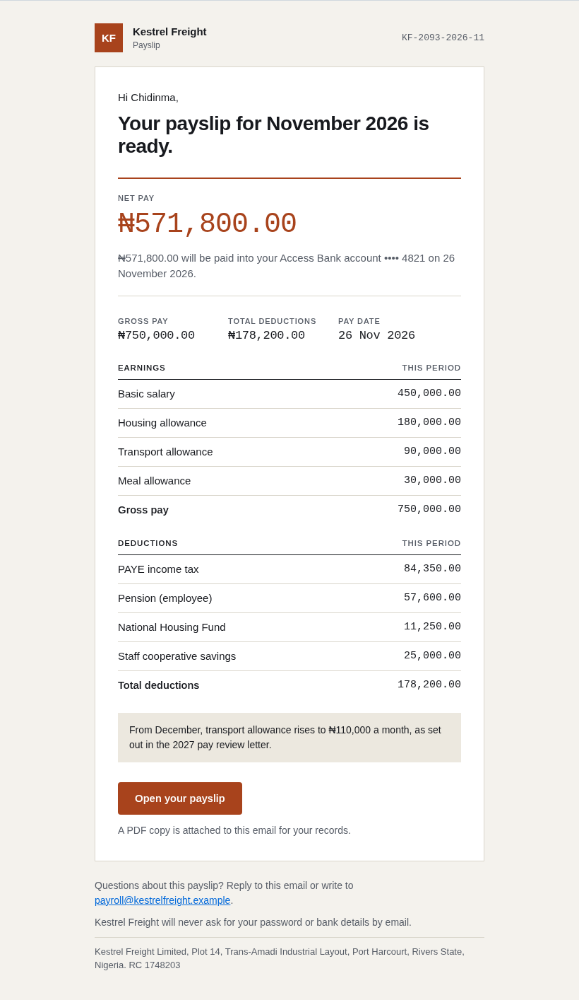
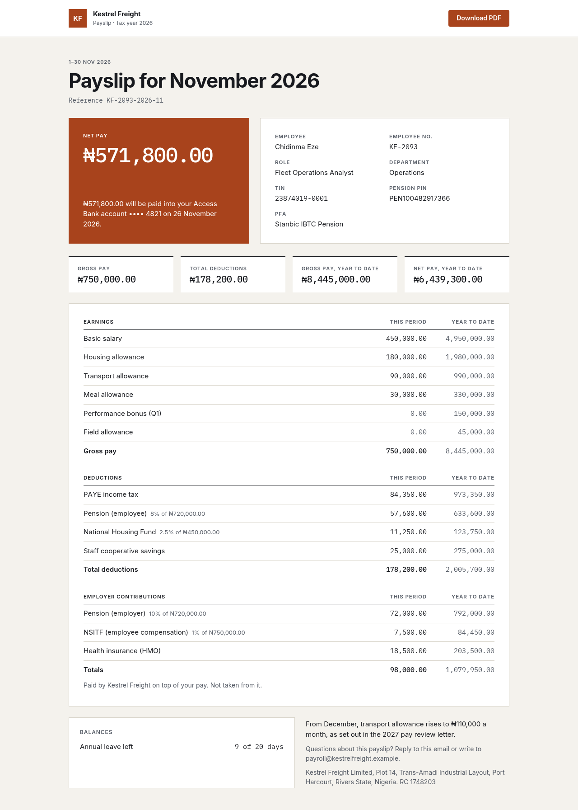
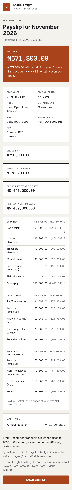
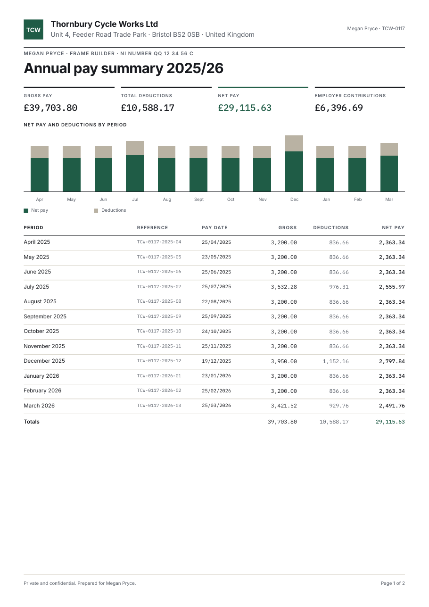

# Pay Packet

**One payroll file in. The pay-day email, the web payslip, the A4 PDF, a chat-safe card and a whole tax year of slips out.**

A payslip kit for [Hyper Elements](https://hyperelements.dev), built for the Hyper Elements Template Challenge (November 2026). It is for anyone who has to send payslips: a small company's payroll admin, an HR or payroll product, an accountant running payroll for clients. Bring the numbers from your payroll engine; Pay Packet turns them into the documents employees actually receive, in their language and currency.



**For judges, no install needed:** every output is committed in [`examples/`](examples). Open [`examples/kestrel-freight/`](examples/kestrel-freight) for the default sample, [`examples/thornbury-cycle-works/year/`](examples/thornbury-cycle-works/year) for a full twelve-slip tax year, and [`examples/checks.json`](examples/checks.json) for the gate's result.

## What it makes

From one data file (`data/*.json`), each output with a job only its format can do:

| Output | Root | Job | Sample |
| --- | --- | --- | --- |
| Pay-day email + plain text | `Email` | How much, when, into which account, above the fold; this period's lines; a link to the full slip. The preview text names the month and pay date, never the amount, so a lock screen shows no one's pay. | [`email.html`](examples/kestrel-freight/email.html), [`email.txt`](examples/kestrel-freight/email.txt) |
| Web payslip | `Page` | The whole slip on a responsive page, mostly read on phones: every earning, deduction and employer contribution with this period and the year to date, balances, the period's note, a PDF link. | [`page.html`](examples/kestrel-freight/page.html) |
| A4 payslip | `Document` → `renderPdf()` | The copy people print and send to a landlord or bank: letterhead, employee panel, tables with year to date, net pay band with the year's bars, a footer naming who it is for. Always one page. | [`payslip.pdf`](examples/kestrel-freight/payslip.pdf) |
| Annual summary | `Document` → `renderPdf()` | The tax year on two pages: every period with its slip reference and a stacked chart, then each line totalled. What a lender means by "a year of payslips". | [`annual-summary.pdf`](examples/kestrel-freight/annual-summary.pdf) |
| Chat notice card, 1200×630 | `Canvas` → `renderImage()` | What a payroll bot posts in Slack, Teams or WhatsApp on pay day. Month, pay date, reference, and **no amounts**: chat previews are seen by whoever is near the screen. | [`card-notice.png`](examples/kestrel-freight/card-notice.png) |
| Archive card, 1200×630 | `Canvas` → `renderImage()` | The thumbnail an HR portal or document archive shows for a stored slip: net, gross, deductions and the year's bars with this period marked. | [`card-archive.png`](examples/kestrel-freight/card-archive.png) |
| The year batch | `Document` × N | Every slip of the tax year from the same file, with year-to-date figures carried through. | [`year/`](examples/thornbury-cycle-works/year) (12 slips) |

### Not tied to one country

Currency, locale, tax-year name and every printed word come from the file. Three samples, all fictional:

| File | Company | Locale, currency | Shows |
| --- | --- | --- | --- |
| [`kestrel-freight.json`](data/kestrel-freight.json) | Kestrel Freight, Port Harcourt | en-NG, NGN | Allowances, pension and NHF as percentages of named earnings, a Q1 bonus, employer pension, NSITF and HMO |
| [`thornbury-cycle-works.json`](data/thornbury-cycle-works.json) | Thornbury Cycle Works, Bristol | en-GB, GBP | A complete April–March tax year (12 slips), overtime as hours × rate, a Christmas bonus, student loan |
| [`brueckner-akustik.json`](data/brueckner-akustik.json) | Brückner Akustik, Leipzig | de-DE, EUR | **Every label in German** through the file's `labels`, social insurance as percentages of gross, Urlaubsgeld and Weihnachtsgeld |



Currency formatting uses `Intl.NumberFormat`, so a currency's own minor unit is respected (JPY has none, KWD has three), and every figure is computed in whole minor units so totals never drift.

**Honest scope:** Pay Packet renders payroll; it does not calculate income tax. Tax lines are amounts your payroll engine supplies. Lines that really are a rate (a pension contribution, a housing fund) can be given as `percent` of `"gross"` or of named earning codes and are worked out and rounded once, half up. The sample figures are illustrative, not statutory advice for any country.

## How Hyper Elements is used

| What | Where |
| --- | --- |
| **All four roots**, each with its own job: `Email`, `Page`, `Document` (two of them), `Canvas` (two variants) | [`templates/`](templates) |
| **One theme**, `defineTheme()` with colour, font, size and line-height tokens, element defaults (a heading type scale, Button, Divider), named styles (`card`, `label`, `figure`) and per-format overrides (`formats.document` white paper and 10.5px body, `formats.canvas`). Each company gets its accent through **`extendTheme()`** | [`src/theme.ts`](src/theme.ts) |
| **`defineElement()`** for typed, validated blocks: `paypacket.Monogram` (the company's letters on its accent, a logo that shows with images off) and `paypacket.Figure` (a label over an amount) | [`src/parts.tsx`](src/parts.tsx) |
| **Shared components across roots**: the same `PayTable`, `Details` and `Letterhead` build the email, the page and both PDFs, so a figure cannot differ between them | [`src/parts.tsx`](src/parts.tsx) |
| **`Table` / `TableRow header` / `TableRow footer` / `TableCell`** for every pay table, totals as footer rows | `PayTable` in [`src/parts.tsx`](src/parts.tsx) |
| **Document parts**: `PageHeader`, `PageFooter`, `PageNumber` and `PageNumber total`, `Document.Page` for the annual summary's two pages | [`templates/payslip-pdf.tsx`](templates/payslip-pdf.tsx), [`templates/annual-summary.tsx`](templates/annual-summary.tsx) |
| **`Svg` with `Rect`, `Line`, `Path`** for the year's bars and the drawn payslip, only in the PDF and Canvas (an Email gets no Svg) | [`src/chart.tsx`](src/chart.tsx), [`templates/payslip-card.tsx`](templates/payslip-card.tsx) |
| **Phone styles and `hidden`** in the Email and Page only: type steps down, panels stack, the Page swaps its tables for narrower phone columns | [`templates/payslip-email.tsx`](templates/payslip-email.tsx), [`templates/payslip-page.tsx`](templates/payslip-page.tsx) |
| **`render()`** for the email's HTML and plain-text twin and the page's HTML; **`renderPdf()`** and **`renderImage()`** natively, with fonts passed as bytes, so nothing is fetched at render time and no headless browser is involved | [`scripts/make.tsx`](scripts/make.tsx), [`src/fonts.ts`](src/fonts.ts) |
| **The gate**: the data checks, then **`validate()`** on every artefact, with **`emailClients()`** (`@hyper-elements/email-clients`) and **`lint()`** (`@hyper-elements/lint`, transactional) on the email and `lint()` on the page. Errors **and warnings** fail it; `make` renders nothing unless it passes | [`scripts/lib.tsx`](scripts/lib.tsx), [`src/check.ts`](src/check.ts) |
| **`renderInEmailClients()`** previews of classic Outlook, Gmail (web and app) and Apple Mail (light, dark, iPhone), screenshotted | [`scripts/shots.tsx`](scripts/shots.tsx), [`examples/kestrel-freight/clients/`](examples/kestrel-freight/clients) |
| **Gallery-ready**: every template file has `export const meta = { title, description, root }` and a default export that renders the sample with no props, the shape of the official gallery's templates, so `npx hyper-elements check templates/payslip-email.tsx` works on any of them | [`templates/`](templates) |

The email is email-safe by construction: no Svg, no images at all (the monogram is a box of text), every `Row`'s columns sized for classic Outlook. The current gate result is in [`examples/checks.json`](examples/checks.json): **0 errors, 0 warnings** across 49 artefacts. The notes it counts are the things a client draws slightly differently (Outlook squares corners and draws 500-weight text as normal; labels are under 14px), each a known, accepted trade-off.

### In email clients

| Classic Outlook | Gmail app | Apple Mail, dark |
| --- | --- | --- |
|  |  |  |

What each client removed or changed is in [`clients/findings.json`](examples/kestrel-freight/clients/findings.json). These are the library's local client models, not a send to real inboxes.

### More previews

| Web payslip, desktop | Web payslip, phone | Annual summary |
| --- | --- | --- |
|  |  |  |

## Run it

Node.js 20 or later.

```bash
npm install
npm run check   # the gate: data checks + validate() + emailClients() + lint(), writes examples/checks.json
npm run make    # gate, then every output for every file in data/ into examples/<file>/
npm test        # 34 tests: money and rounding, YTD carry-through, data rules, the gate, privacy of the preview text and notice card, one-page PDFs
npm run shots   # optional: README screenshots and email-client previews (needs Chrome and poppler's pdftoppm)
```

Your own payroll: copy a file in `data/`, change it, and run `npm run make -- data/your-file.json`. Any template also renders on its own with the official CLI, for example `npx hyper-elements check templates/payslip-email.tsx`.

In an app, render from code:

```tsx
import { render } from "@hyper-elements/react";
import { renderPdf } from "@hyper-elements/react/pdf";
import PayslipEmail from "./templates/payslip-email";
import PayslipPdf from "./templates/payslip-pdf";
import { loadFonts } from "./src/fonts";

const { html, text } = await render(<PayslipEmail file={payroll} period="2026-11" />);
const { pdf } = await renderPdf(<PayslipPdf file={payroll} period="2026-11" />, { fonts: await loadFonts() });
// send html + text with your email provider, with pdf attached
```

## The data file

```jsonc
{
  "company":  { "name", "monogram", "legalName", "address": [], "registration", "payrollEmail", "portalUrl", "accent" },
  "settings": { "locale": "en-NG", "currency": "NGN", "taxYear": "2026", "frequency": "monthly" },
  "labels":   { /* optional: any printed word, e.g. the German sample's */ },
  "employee": { "id", "name", "firstName", "role", "department", "startDate", "email", "taxId": { "label", "value" }, "references": [], "payment": { "method", "bank", "account" } },
  "pay": {
    "earnings":   [{ "code": "BASIC", "label": "Basic salary", "amount": 450000 }],
    "deductions": [{ "code": "PEN", "label": "Pension (employee)", "percent": 8, "base": ["BASIC", "HOUSE", "TRANS"] }],
    "employer":   [{ "code": "ERPEN", "label": "Pension (employer)", "percent": 10, "base": ["BASIC", "HOUSE", "TRANS"] }]
  },
  "periods": [{ "id": "2026-11", "start": "2026-11-01", "end": "2026-11-30", "payDate": "2026-11-26",
                "earnings": [/* this period's own lines: replace by code or add */], "omit": [], "status": "paid",
                "balances": [{ "label": "Annual leave left", "value": "9 of 20 days" }], "message": "..." }]
}
```

A line is a fixed `amount`, `hours` × `rate`, or a `percent` of a `base`. A line paid earlier in the year stays on later slips at zero, so year-to-date columns always add up. An `"unpaid"` period has no slip and leaves the year to date unchanged. Types: [`src/types.ts`](src/types.ts).

The data checks ([`src/check.ts`](src/check.ts)) refuse, with the path to fix: an unknown currency or locale, a percentage of an earning that doesn't exist, overlapping periods, a pay date before its period, a line with two ways to work it out, a negative net pay, and an unmasked bank account number.

## Layout of the repo

```
data/                 three sample payroll files (fictional companies and people)
src/types.ts          the data file's shape and every label
src/payroll.ts        the year worked out: lines, totals, YTD carry-through, references
src/money.ts          minor units, rounding, Intl formatting
src/check.ts          data checks, run before validate()
src/theme.ts          defineTheme() + extendTheme() per company
src/parts.tsx         defineElement() blocks and shared components
src/chart.tsx         the year's bars in Svg
templates/            the five templates (Email, Page, Document x2, Canvas)
scripts/              check, make, shots
examples/             every rendered output, committed
tests/                vitest
assets/fonts/         Inter and IBM Plex Mono (SIL OFL 1.1, licences included)
```

## Design

Warm paper, black ink, hairline rules, and one accent per company kept for the figure that matters: net pay. Words are in Inter; every amount, date and reference is in IBM Plex Mono, the way payslips were printed, so columns line up in every output without relying on tabular-figure support. No gradients, no emoji, no stock images.

## Limits

- Hyper Elements Documents do not flow content across pages, so the payslip is designed as one page and steps its type down for long payrolls (more than 10 and 14 lines). The annual summary uses two explicit pages; a tax year with more than 13 periods (weekly pay) would need its table split.
- Phone styles cannot change a table cell's width, so the web page renders a narrower copy of its tables for phones and hides the desktop one.
- Email clients get the font stacks only (web fonts are unreliable in email); the PDF and PNG embed Inter and IBM Plex Mono.

## Licence

MIT, see [LICENSE](LICENSE). Fonts: Inter and IBM Plex Mono under the SIL Open Font License 1.1 ([`assets/fonts/`](assets/fonts)). All companies, people and figures in `data/` are fictional.
